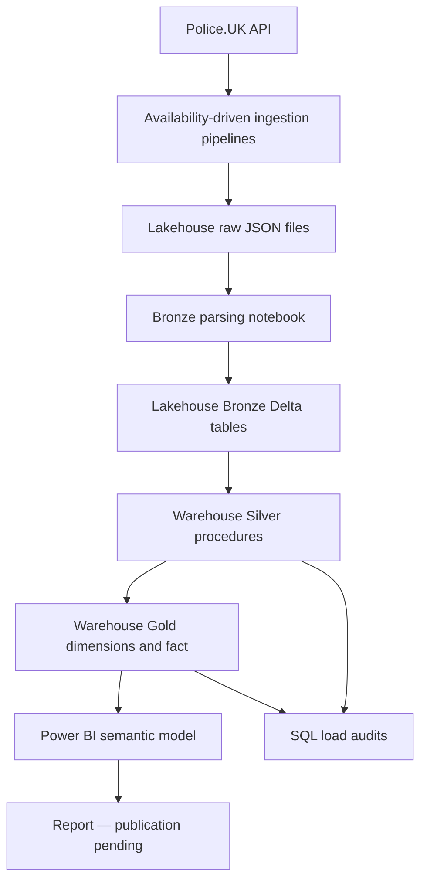
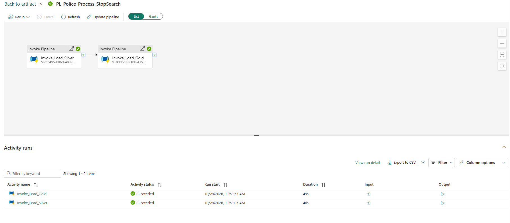
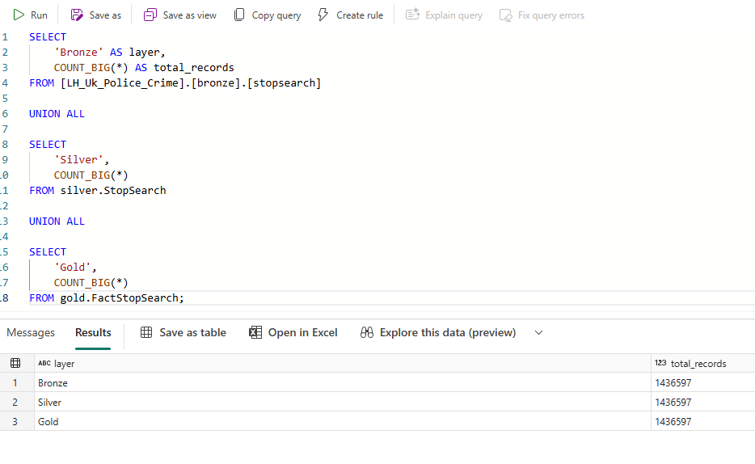

# UK Police Stop and Search Analytics Platform

**An independent Microsoft Fabric data engineering portfolio project by Femi Akanni**

Microsoft Fabric · Data Factory pipelines · OneLake · PySpark · T-SQL · Fabric Warehouse · Power BI

From a public API to an audited dimensional warehouse: **1,427 force/month files, 1,436,597 source records, 42 contributing forces and 36 publication months** reconciled through Bronze, Silver and Gold.

> Independent portfolio work using public Police.UK data. This is not an official police or government system. The fictional commissioning scenario provides business context; it does not represent paid client delivery.

## Explore the project

| Start here | What you will find |
|---|---|
| [Business case and scope](docs/business-case.md) | The analytical problem, questions and boundaries |
| [Architecture and data flow](architecture/architecture-overview.md) | Rendered diagrams, components and engineering decisions |
| [Setup and reproduction guide](SETUP.md) | Build order, prerequisites and current reproducibility boundaries |
| [Verified notebook walkthroughs](notebooks/reference-walkthrough.md) | Reference refresh code and [profiling export review](notebooks/stop-search-profile-review.md) |
| [Verified pipeline definitions](ingestion/verified-pipelines.md) | Six sanitised inline definitions and the confirmed Gold scope correction |
| [API ingestion walkthrough](ingestion/api-to-bronze.md) | Availability-driven extraction, expressions, raw retention and recovery |
| [Complete inline SQL procedures](implementation/complete-procedures.md) | Seven complete reconstructions from the project build history |
| [Reconstructed Bronze writer](notebooks/bronze-writer-reconstruction.md) | Complete raw-file parser and writer, clearly labelled and not deployed |
| [SQL Silver transformation](implementation/silver.md) | JSON parsing, UK time conversion, scoped replacement and reconciliation |
| [Dimensional warehouse](implementation/gold.md) | Dimension maintenance, null-safe joins and fact loading |
| [Data dictionary](docs/data-dictionary.md) | Grain, columns, measures and lineage |
| [Orchestration and recovery](monitoring/operations.md) | Pipelines, audit records, transactions and failure handling |
| [Validation evidence](tests/validation.md) | Confirmed counts, quality observations and evidence status |
| [Power BI model and DAX](powerbi/README.md) | Relationships, starter measures and report publication status |
| [Limitations and next steps](docs/limitations.md) | What is implemented, what remains and what is not claimed |

## The engineering problem

A public JSON endpoint is not an analytical platform. Force-level availability varies by month, records contain nested and missing fields, and publication months do not always align with local event dates. Analysts need a repeatable way to compare recorded searches without losing source records or silently multiplying them through joins.

This project preserves raw responses, converts them into traceable Bronze records, applies set-based SQL transformations, resolves dimension keys and exposes a star schema to Power BI. The implemented analytical scope is **Stop and Search**, rather than the wider crime/ASB/outcomes platform considered during discovery.

## Implemented results

| Checkpoint | Project snapshot |
|---|---:|
| Publication months loaded | September 2023–August 2026 |
| Force reference entries | 44 |
| Forces contributing loaded records | 42 |
| Planned force/month responses loaded | 1,427 / 1,427 |
| Bronze records | 1,436,597 |
| Silver records | 1,436,597 |
| Gold fact records | 1,436,597 |
| Reconciliation difference | 0 |

These are results from the completed project snapshot, not a promise of permanent source availability or complete UK coverage. Counts and successful runs were confirmed during implementation; two notebook exports, six pipeline exports and nine screenshots have now been reviewed. Verified notebook code is included inline; all nine owner-approved screenshots are now published in the [evidence gallery](docs/evidence-gallery.md).

## Solution at a glance

**Automation boundary:** the tested processing parent runs existing **Bronze → Silver → Gold**. API ingestion and raw-to-Bronze preparation remain separate components; a fully scheduled source-to-report monthly workflow is future work.

## Verified execution and reconciliation

*Successful ordered processing of existing Bronze data through Silver and Gold; this parent does not perform API ingestion.*

*The captured three-layer reconciliation shows zero row-count difference. See the [full evidence gallery](docs/evidence-gallery.md) for audit scope and configuration findings.*

## Engineering decisions worth inspecting

- **Drive requests from actual availability.** Expand each month's advertised contributing force list instead of assuming every force supplies every month.
- **Retain raw responses.** Replay transformations without repeating a long historical API extraction.
- **Preserve source-record grain.** The file path and zero-based array index identify a row within an ingested file version. Similar-looking searches are not deduplicated as people or incidents.
- **Use Warehouse for write-heavy T-SQL.** The Lakehouse retains raw and Bronze data; Warehouse procedures implement Silver and Gold.
- **Replace a selected scope transactionally.** Force/month parameters support controlled reprocessing without appending duplicates.
- **Resolve dimensions before facts.** Missing dimension matches fail the fact load; row counts catch join multiplication.
- **Audit execution.** Wrappers persist load scope, counts, UTC timing, status and the child pipeline run ID.

## Live report — publication pending

**Report name:** UK Police Stop and Search Insights  
**Planned file:** `UK_Police_Stop_Search_Insights.pbix`  
**Semantic model:** `SM_Police_StopSearch`

[View report publication status](powerbi/README.md#publication-status)

The report is being built. There is no public report URL or report screenshot yet. This link opens the status page rather than a fabricated Power BI address. The final public URL will be added after publication.

## Source and responsible interpretation

Data is supplied through [data.police.uk](https://data.police.uk/). See the [source register](docs/sources.md) for API dictionaries and attribution. Counts describe published search records, not unique people, crime rates, or police effectiveness. Published coordinates are approximate. Demographic comparisons require coverage context and appropriate denominators; this project does not calculate population-adjusted disproportionality.
