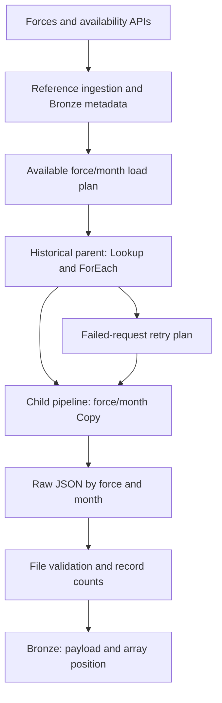
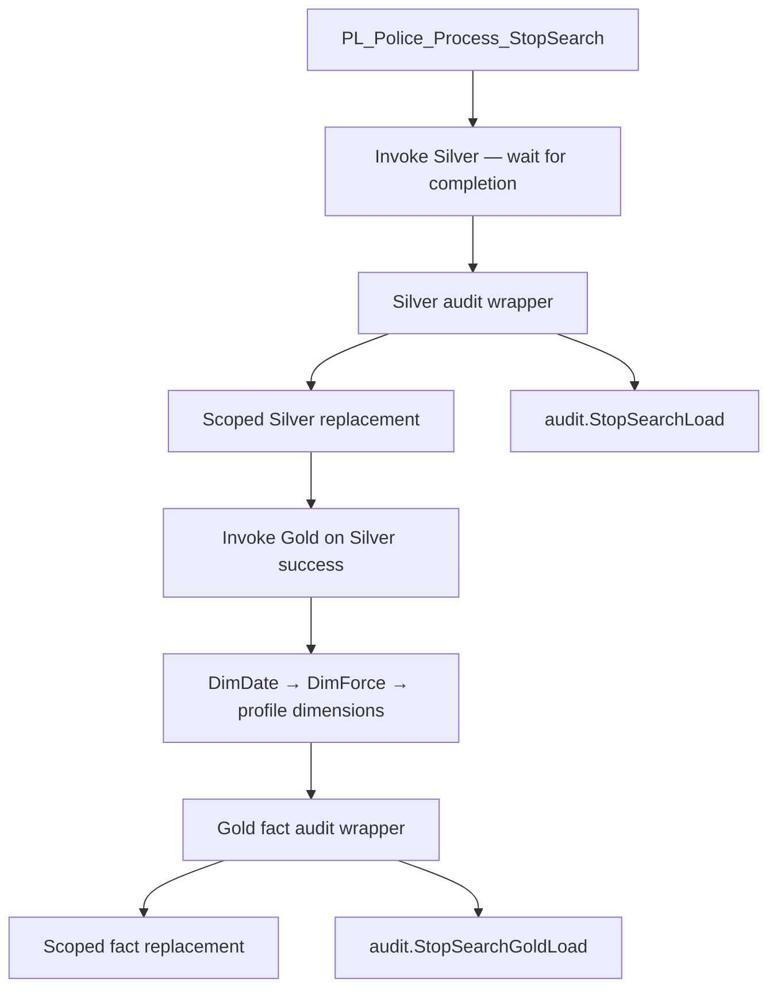
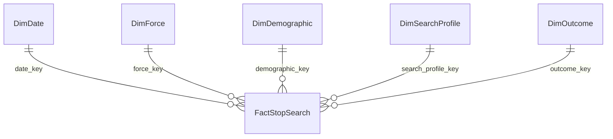

# Architecture and data flow

[Back to project](../README.md)

## Storage and execution boundaries

| Component | Responsibility |
|---|---|
| `LH_Uk_Police_Crime` | Raw JSON files, Bronze Delta tables, extraction control and file audit tables |
| Lakehouse SQL analytics endpoint | Read access to Bronze from Warehouse queries |
| `WH_Police_Analytics` | Writable `silver`, `gold` and `audit` schemas and SQL stored procedures |
| Fabric Data Factory pipelines | Parameter passing, ordered execution and activity monitoring |
| PySpark notebooks | Reference ingestion and raw JSON to Bronze preparation |
| `SM_Police_StopSearch` | Direct Lake analytical model over Gold tables |

The original single-Lakehouse schema proposal was revised after implementation friction and a preference for SQL-heavy processing. Using a Warehouse provides a practical writable T-SQL layer while retaining the Lakehouse as the source replay boundary. These are two Fabric items, not three separate medallion Lakehouses.

## API to Bronze

The historical copy activities were executed sequentially. Four failed requests were recovered through a reduced retry plan, and all 1,427 planned files were subsequently validated. This is operational experience rather than a controlled concurrency benchmark.

## Tested processing parent

The parent does not currently invoke API ingestion or the Bronze notebook. Each child writes its own pipeline run ID. A shared end-to-end correlation ID is not yet implemented.

## Star schema

All Power BI relationships are active, single-direction, dimension-to-fact, one-to-many. No dimension-to-dimension relationships are required.

## Grain and key decisions

The fact represents one ingested array record. It does not represent a unique person. `source_file` plus `source_record_index` supports replay and tracing within the current raw-file version. A correction can reorder a response; the pair must not be advertised as a persistent source event key.

Date keys are `YYYYMMDD`; key 0 represents an unusable date. Other dimensions use integer surrogate keys, with an all-missing member at key 0. New combinations are appended without changing existing keys. Force names are refreshed using Type 1 overwrite. No Type 2 force-name history is implemented.

The manual `MAX(key) + ROW_NUMBER()` allocation requires serial execution. Transactions protect a load, but do not make this allocation a general-purpose concurrent key service.
