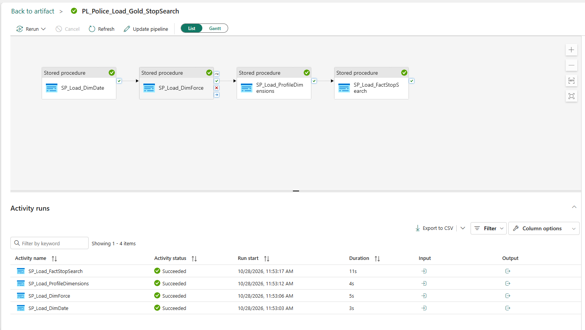
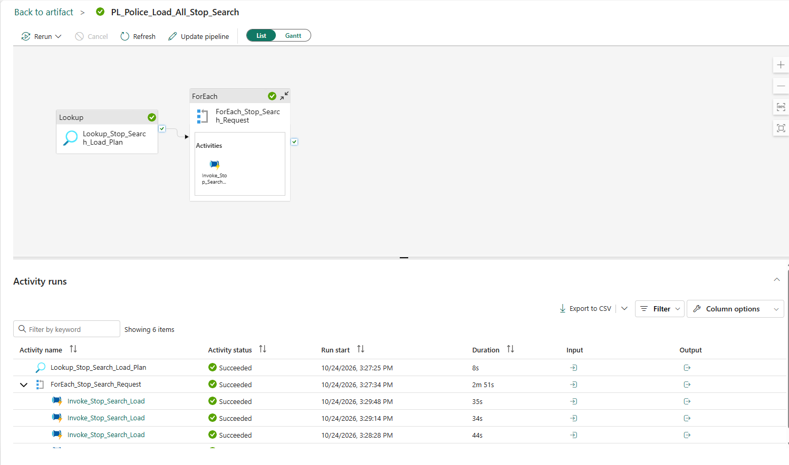
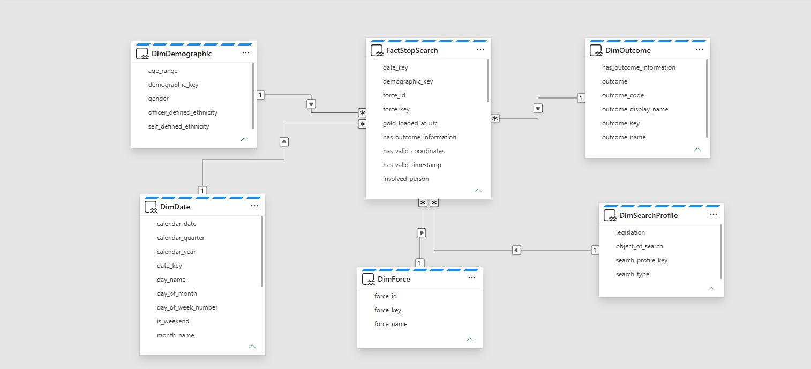
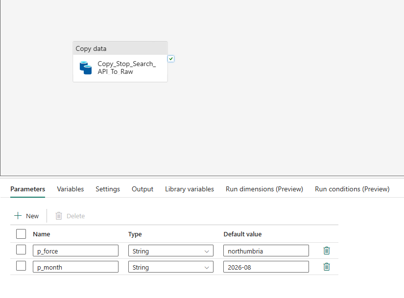
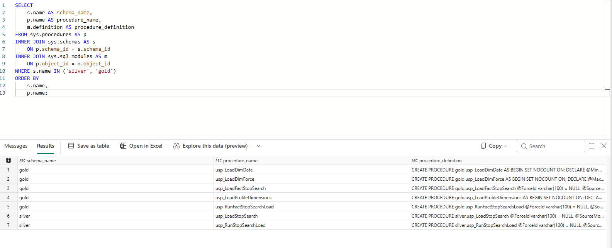

# Implementation evidence gallery

[Back to project](../README.md)

Nine owner-supplied screenshots, published with explicit permission on 29 October 2026. Captions limit claims to what each capture actually shows. Visible Fabric item names and execution metadata belong to this portfolio environment. These are implementation captures, not performance experiments or a production SLA.

## Successful processing parent

Silver followed by Gold, both successful. This processes existing Bronze data; it does not prove a fully automated API-to-report refresh.

## Successful Gold child

Four ordered stages: Date, Force, profile dimensions and fact. Scope must be checked in the audit and parameter mapping.

## Historical ingestion recovery

A short successful recovery run through Lookup, ForEach and invoked requests. It does not show the complete historical backfill in one execution.

## Semantic model

Five dimension-to-fact relationships are visible around FactStopSearch. Report authoring and publication are separate pending work.

## Scoped Silver audit

Metropolitan / 2025-08: Bronze and Silver each show 14,899 records and successful status.

## Full-load Gold audit

Force/month are NULL; Silver and Gold each show 1,436,597 records and successful status. These captures do not demonstrate scoped Gold processing.

## Parameterised API child

One Copy activity with p_force and p_month string parameters. Default values shown are Northumbria / 2026-08.

## Three-layer reconciliation

The query result shows 1,436,597 records in each of Bronze, Silver and Gold.

## Stored-procedure catalogue

Seven procedures are visible across Silver and Gold. Displayed definition text is truncated; this image is not a full SQL export.

