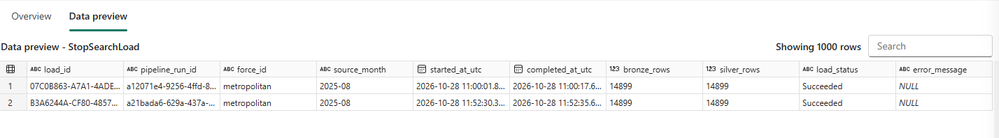
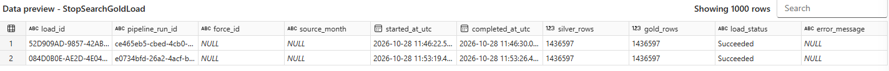

# Orchestration, audits and recovery

[Back to project](../README.md)

## Normal processing entry point

Run `PL_Police_Process_StopSearch`. It calls the Silver child, waits for completion and invokes Gold only on Silver success. Gold runs Date, Force, profile dimensions and fact in order.

| Parent input | Meaning |
|---|---|
| Both strings empty | Replace all currently loaded Bronze data in Silver and all Silver data in the fact |
| Force only | Replace that force across loaded publication months |
| Month only | Replace that publication month across contributing forces |
| Force and month | Replace one selected scope |

The parent passes parameters directly to each child:

```text
@pipeline().parameters.p_force_id
@pipeline().parameters.p_source_month
```

The children convert an empty or whitespace-only string into a SQL NULL:

```text
@if(empty(trim(pipeline().parameters.p_force_id)), null, trim(pipeline().parameters.p_force_id))
```

```text
@if(empty(trim(pipeline().parameters.p_source_month)), null, trim(pipeline().parameters.p_source_month))
```

For the audit wrapper's `PipelineRunId` parameter:

```text
@pipeline().RunId
```

The run IDs belong to the individual Silver or Gold child, not the parent. Parent-to-child navigation is available in Fabric according to the invoke activity used; shared parent correlation is a future enhancement.

## Audit tables

`audit.StopSearchLoad` records Silver processing. `audit.StopSearchGoldLoad` records Gold fact processing. Each includes a generated load ID, pipeline run ID, optional force/month, start and completion UTC timestamps, source/target counts, status and error text.

```sql
SELECT TOP (20)
    pipeline_run_id, force_id, source_month,
    started_at_utc, completed_at_utc,
    DATEDIFF(SECOND, started_at_utc, completed_at_utc) AS duration_seconds,
    silver_rows, gold_rows, load_status, error_message
FROM audit.StopSearchGoldLoad
ORDER BY started_at_utc DESC;
```

A Running row can remain after cancellation, disconnection or interruption. Audit insertion/update failures can themselves prevent a complete audit trail. A failed wrapper after a successful inner commit can mean data was committed but post-load auditing failed; inspect target state before deciding what to rerun. These wrappers are useful operational records, not an exactly-once distributed execution ledger.

## Recovery playbook

| Symptom | Action |
|---|---|
| API request failure | Inspect the failed pair; populate a reduced retry plan and run only missing requests |
| Invalid raw response | Inspect retained content; do not parse an error body as a valid empty dataset |
| Bronze parsing issue | Repair parsing, inspect notebook write mode and rebuild the affected raw-file scope |
| SQL invalid object name | Confirm database/schema/table in endpoint metadata; fix exact case; close an abandoned transaction in the same session |
| Missing fact dimension match | Run dimension loaders first, investigate source combinations and rerun the same fact scope |
| Count mismatch | Investigate source positions and dimension uniqueness; loader rolls back target replacement |
| Parent fails in Gold | Silver may already be committed; repair Gold and rerun Gold for the same scope |
| Audit remains Running | Compare with Fabric activity history before marking it abandoned |

Manual cleanup for a known abandoned transaction, in the affected query session:

```sql
IF @@TRANCOUNT > 0 ROLLBACK TRANSACTION;
SELECT @@TRANCOUNT AS open_transactions;
```

## Workspace organisation

| Folder | Items |
|---|---|
| `01_Data_Stores` | `LH_Uk_Police_Crime`, `WH_Police_Analytics` |
| `02_Reference_Data` | `PL_Police_Load_Forces`, `NB_Police_Load_Bronze_Reference` |
| `03_API_Ingestion` | `PL_Police_Load_Stop_Search`, `NB_Police_Load_Bronze_StopSearch` |
| `04_Processing` | `PL_Police_Process_StopSearch`, `PL_Police_Load_Silver_StopSearch`, `PL_Police_Load_Gold_StopSearch` |
| `90_Backfill_Recovery` | `PL_Police_Load_All_Stop_Search` |
| `99_Development` | Temporary checks pending review |

Keep raw files, load/retry-plan tables and called procedures while dependencies exist. Archiving a historical pipeline is not deleting the implementation. Reference notebooks and ingestion components remain useful for refreshes and replay.

## Scheduling boundary

No fully automated monthly API-to-report schedule is documented as complete. Do not enable a historical backfill schedule accidentally. Before scheduling, add source availability refresh, an ingestion success ledger, safe Bronze updates, shared run correlation, no-overlap controls and report-model refresh handling. Existing SQL dimensions use serial key allocation.

## Scope alignment check from supplied evidence

The reviewed Silver audit shows Metropolitan / August 2025 (14,899 records), while the Gold audit captures show NULL force/month (full-scope 1,436,597 records). Verify that `Invoke_Load_Gold` passes both parent parameters and that the Gold fact wrapper receives them through its dynamic expressions. A successful full Gold load is correct for the full scope, but does not demonstrate the intended selected-scope propagation. Avoid describing this evidence as a successful matched-scope end-to-end test until a fresh scoped Gold audit confirms it.

## Export verification — 29 October 2026

Six pipeline templates were reviewed. The exact cause of full Gold reloads is now confirmed: the parent passes the scope correctly, but `SP_Load_FactStopSearch` sends empty literal SQL parameter values. Replace them with the dynamic force/month expressions shown in the [verified pipeline review](../ingestion/verified-pipelines.md). The correction has not been applied to Fabric or proven by a fresh audit yet. Exported processing defaults are Metropolitan / 2025-08, and the invoke activities are newer InvokePipeline activities, not Legacy. Activity retry policies are currently zero; failed historical requests were recovered manually.

## Published audit evidence



*Scoped Silver loads succeeded and their Bronze/Silver counts match.*



*Gold audit scopes are NULL. These are full replacements, not proof of the intended scoped Gold test; the exported mapping correction remains to be confirmed.*
